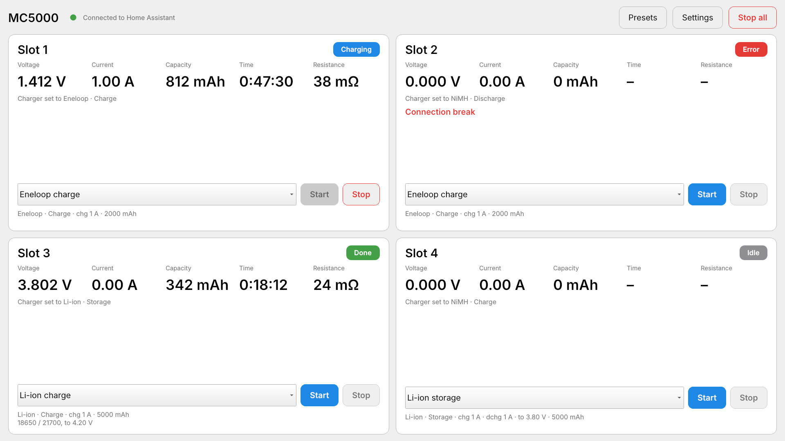
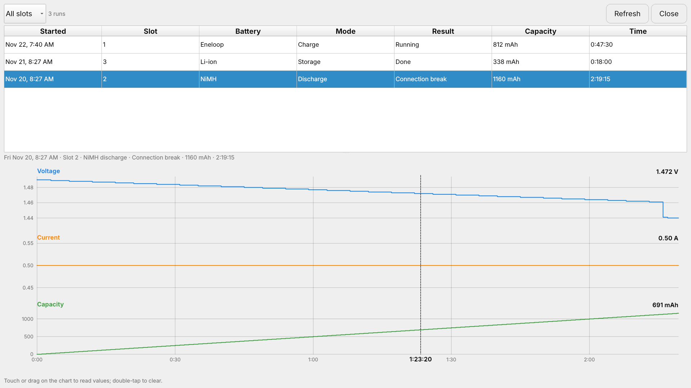

# MC5000 Bench

A touch-friendly Linux desktop app for a SkyRC MC5000 that's set up in Home
Assistant with the `skyrc_mc5000` integration from this repository (0.2.4 or
later for cycle order and restart voltage).

Home Assistant keeps its Bluetooth connection to the charger. This app never talks
Bluetooth: it reads the charger's entities and sends commands through Home
Assistant's WebSocket API, so you can use it alongside the dashboard.





- Four slot cards with live voltage, current, mAh, time and internal resistance.
- A preset picker on every slot: pick "Eneloop charge" or "Li-ion storage", press
  Start, confirm.
- Presets you can add, copy, reorder and edit (battery type, mode, currents,
  capacity, storage voltage, discharge cutoff, cycles and cycle order). The modes
  offered follow what the charger allows for each chemistry, and values are
  limited to what the integration accepts.
- Advanced settings per preset: charge voltage (e.g. 4.10 V for longer Li-ion
  life), end currents, rest between phases, −ΔV and trickle for NiMH,
  temperature and time limits, and a Li-ion restart voltage.
- Cycle runs report the capacity measured during discharge ("1950 mAh out").
- **Curves:** the Curve button on a slot shows voltage, current, capacity (and
  temperature, if that sensor is enabled in Home Assistant) for the current or
  latest run, updating live. Touch or drag to read values at any moment. With
  integration 0.5.0+, a running slot's voltage comes from the charger's own memory
  (one sample a second early on, thinning to about every 16 s by the end of an
  hour-long run; HA polls every 10 s), and that detail is kept in the saved run.
- **History:** every run from Home Assistant's recorded history, even ones that
  ran while the app was closed, with its result (Done, Stopped or the charger's
  error), final mAh and time, and its curve. The charger zeroes its mAh counter
  when a run ends in an error; the history keeps the last reading before that.
- Finished runs are copied to `~/.local/share/mc5000-bench/runs/`, so they stay
  after Home Assistant purges old history (10 days by default). Open the app at
  least once within that window to keep every run.
- **Charger** button: the charger's own settings (screen backlight, screen timeout,
  keypress beep, alert beep, completion tone), changed through Home Assistant
  (integration 0.3.0+).
- A USB-C readout in the header (power, voltage, current) while the charger's
  USB-C port is powering something.
- Stop per slot, Stop all, and a banner with a Reconnect button when Home
  Assistant's charger connection is paused for the SkyRC app.

## Install (Debian / Ubuntu)

```sh
sudo apt install pipx git libxcb-cursor0
pipx ensurepath
pipx install "git+https://github.com/fisherbln/skyrc-mc5000.git#subdirectory=bench"
mc5000-bench --install-desktop   # adds it to the app menu
```

Start it from the app menu or with `mc5000-bench` (`--fullscreen` to fill a
touch screen). On first start it asks for:

- **Address**: your Home Assistant URL, e.g. `http://homeassistant.local:8123`.
- **Access token**: in Home Assistant open your profile → Security →
  Long-lived access tokens → Create token.

Update later with `pipx upgrade mc5000-bench`.

## Files

Everything lives in `~/.config/mc5000-bench/`: `settings.json` (address and
token, readable only by you), `presets.json`, `selection.json` (each slot's
chosen preset) and `results.json` (last run per slot).

## Development

```sh
cd bench
python3 -m venv .venv && .venv/bin/pip install -e . pytest
QT_QPA_PLATFORM=offscreen PYTHONPATH=tests .venv/bin/pytest
```

The tests run the app against a small fake Home Assistant (`tests/fakeha.py`).
